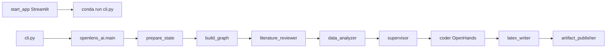
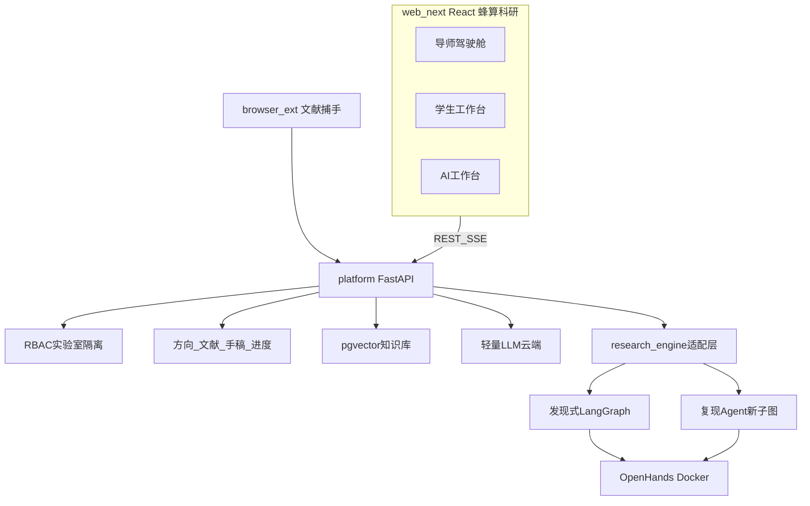
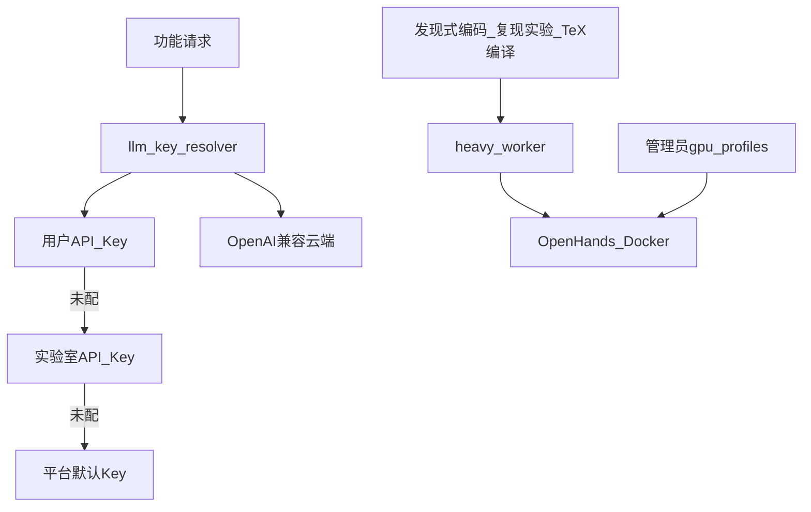
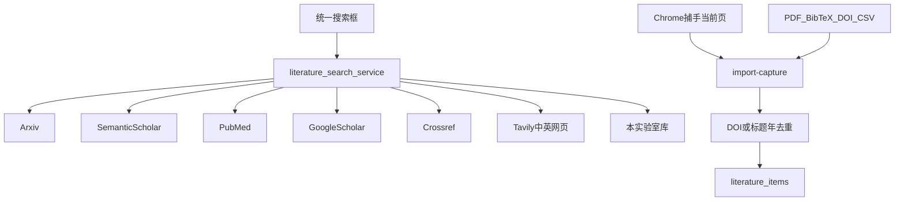
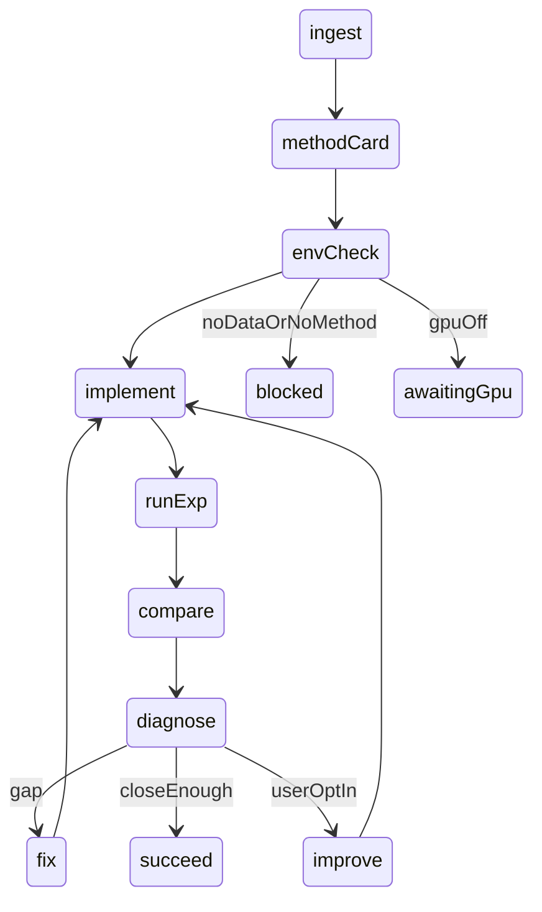

# 蜂算科研：长期落地施工计划

> 产品名：
>
> **蜂算科研**
>
> 。OpenLens AI 是底层研究引擎（发现式流水线 + OpenHands），不出现在用户主界面标题；「关于 / 引擎版本」与开源协议声明可标注 powered by OpenLens。
> 本文件面向 
>
> **coding agent（Cursor / Codex / Claude Code 等）**
>
>  与人类共同维护。目标：把仓库 
>
> `E:\openlens-ai`
>
>  从「单机全自主科研智能体」升级为 
>
> **综合型高校实验室的科研操作系统 × 多 Agent 引擎**
>
> 。
> 按 
>
> **H1：M0 → M8**
>
>  顺序执行。
>
> **每一阶段通过验收标准后再进入下一阶段。**
>
>  本文件第 1 节决策已全部拍板，
>
> **禁止再当作可选项推翻**
>
> 。若实施中出现本文件未记录的新决策，必须停下向用户确认，不得擅自拍板。
> 全文按 
>
> **正式上线产品**
>
>  写。禁止「演示 / Demo / 样板间」口吻。验收走真实工作流。出厂引导实验室必须可删除。


***

## 0. 执行公约（给 coding agent）

把本文件交给 agent 时附加：

> 请阅读 
>
> `docs/PLATFORM_UPGRADE_PLAN.md`
>
> ，严格按 H1 从 M0 开始逐阶段实施。每一阶段：先读该阶段「任务清单」和「验收标准」→ 实施 → 运行验收命令 → 通过后再进下一阶段。禁止跳过阶段。禁止改变第 1 节已拍板的技术栈与产品规则。禁止修改 
>
> `openlens_ai/agents/`
>
>  与 
>
> `openlens_ai/build_graph.py`
>
>  的流水线语义。

约定：


* 路径默认相对仓库根目录（Windows 开发机为 `E:\openlens-ai`）。

* 新代码与既有代码并存。**不得删除或破坏 OpenLens 原有科研流水线**，只能新增目录或包裹式改造。

* 提交规范：每个阶段完成一次 `git commit`，message 以 `[H1Mx]` 开头（例如 `[H1M1] 建立 FastAPI 认证与实验室 RBAC`）。

* 代码注释、用户可见文案、本文件使用中文（与 `README_CN.md` 一致）。界面标题写「蜂算科研」。

* Streamlit（`webui/`）仅保留为引擎调试控制台，**不再扩展为产品主 UI**。

* 复现 Agent 只新增 `openlens_ai/agents/paper_reproducer/`，**不插入**现有线性主图。

* 不启用 Sci-Hub。不实现付费墙绕过。不实现键鼠 / 屏幕监控。

* 用户 / 实验室 API Key 加密存储，日志脱敏；接口只回显后四位。

* 无 GPU 时禁止伪造实验指标。

* 每阶段验收不过，不准进入下一阶段。


***

## 1. 决策日志（已拍板，禁止再改）


| 编号      | 主题    | 决定                                                                                                                                   |
| ------- | ----- | ------------------------------------------------------------------------------------------------------------------------------------ |
| D-H1    | 第一期范围 | 实验室 OS 与 AI 工作台 **并行** 交付，约 8–12 周；不是「先只做管理 4–6 周」。                                                                                  |
| D-ENG   | 双引擎   | 发现式（现有 OpenLens：想法 + 数据集 → 实验 + 论文）与真复现（目标论文 → 抽方法 → 实现 → 对比 → 纠错改进）都是一等公民。                                                          |
| D-USER  | 用户画像  | 综合型高校实验室：会议论文、中文期刊、学位论文都会出现。H1 用 `manuscript.kind` 区分类型。                                                                             |
| D-DEG   | 学位与查重 | **开题 / 中期 / 答辩进度轴、官方查重库均放 H2。** H1 把手稿状态做扎实。                                                                                         |
| D-VIS   | 组内透明  | 学生可看同实验室他人的在读、进度、**手稿正文**；仅作者可改正文。老师看全部。加入实验室须知情同意。                                                                                  |
| D-LIT   | 文献    | 中英都要。三条通道：官方 / 开放 API 检索、浏览器捕手（用户已打开且有权访问的页面）、手动 / BibTeX/Zotero/DOI/PDF。                                                            |
| D-CAP   | 捕手法律  | Zotero Connector 模式：用户主动点「导入本页」。禁止付费墙绕过、账号共享爬取、Sci-Hub、无人值守批量爬站。                                                                     |
| D-WRITE | 写作    | 站内编辑器为默认；可选导出 Overleaf zip + 可选 git 推送。                                                                                              |
| D-REG   | 注册    | 邀请制。老师 / 管理员发邀请。                                                                                                                     |
| D-TEN   | 租户    | 单机构多实验室；表预留 `org_id`。不做多机构 SaaS（H3）。                                                                                                 |
| D-NTF   | 通知    | H1：站内 + 邮件。企业微信 H2。                                                                                                                  |
| D-MTG   | 组会    | H1 仅文本纪要 AI，不做 ASR。                                                                                                                  |
| D-WORK  | 工作情况  | 论文 + 任务 + Agent + 自愿工作日志。不做屏幕 / 键鼠监控。                                                                                                |
| D-BRAND | 品牌    | 对外 **蜂算科研**。OpenLens 只作为引擎。                                                                                                          |
| D-STACK | 技术    | PostgreSQL 16 + pgvector；FastAPI + Pydantic v2 + SQLAlchemy 2.0 + Alembic；JWT + bcrypt；React + Vite + Ant Design；自托管 Docker Compose。 |
| D-LLM   | 模型    | 轻量能力走云端 OpenAI 兼容接口（MiniMax / DeepSeek / Qwen / OpenAI 等）。Key 解析：**用户 → 实验室 → 平台默认**。                                                |
| D-GPU   | GPU   | 仅管理员配置 `off / internal / external`。实验室与用户不能改 GPU 拓扑。                                                                                 |
| D-SEED  | 出厂数据  | 可删除的「引导实验室」+ 公开论文 / 小数据集，供空库引导与 CI。真实实验室默认空库 + 批量导入。界面禁止「演示数据」。                                                                      |
| D-FRONT | 前端    | React 从 M1 起并行。不把主 UI 堆到最后。                                                                                                          |

原计划中的 D1–D8 以此表为准，不再开放选择。


***

## 2. 现状解剖（基于仓库真实代码，实施时必须读这些文件）

### 2.1 产品本质

今天的 OpenLens AI 是 **单机全自主科研智能体**（MIT，arXiv 2509.14778），不是实验室管理系统。

输入：`研究想法（question）+ 数据集路径`。输出：文献综述、实验计划、可执行代码、LaTeX、可选 GitHub。

### 2.2 一条作业怎么跑





* 入口：`cli.py` → `openlens_ai/main.py` 的 `main` / `main_resume`。

* UI：`start_app.py` → `webui/frontend_v2.py`。`thread_id` 形如 `OL_<ts>_<question>_<email>_<rand>`。`ProcessManager`：全局最多 10 进程、每用户 1 个。

* 编排：`openlens_ai/build_graph.py` 外层 **固定顺序**。`supervisor` 只写 `plan.md` / `plan.json`，**不动态选择下一个 Agent**。注释掉的 `ALTER_PLAN / REANALYZE_DATA` 条件边 **禁止擅自打开**。

* 断点：`openlens_ai/state.py` 的 `latest_state.json` + `node_call_stack`。没有 LangGraph Checkpointer。

* 消息落盘：`openlens_ai/utils/frontend_messages.py`。蜂算科研必须用适配层订阅这些事件，禁止 React 读 Streamlit session。

作业目录（一次运行 = 一个目录）：


```
{save\_path}/

&#x20; config.toml

&#x20; openhands\_config.toml

&#x20; latest\_state.json

&#x20; plan.md / plan.json

&#x20; workspace/          # 代码、literature\_review.md、manuscript/

&#x20; states/             # step\_\*.json

&#x20; llm\_calls/ tool\_calls/ openhands\_logs/

&#x20; logs/
```

平台把一次运行建模为 `research_runs` 行，目录当工件，元数据进 PostgreSQL。

### 2.3 子图职责（平台任务类型必须一一对应）


| 子图                   | 职责                                                                                              |
| -------------------- | ----------------------------------------------------------------------------------------------- |
| literature\_reviewer | arXiv /medRxiv/ Tavily 循环到 `literature_search_min_tool_call`，写 `workspace/literature_review.md` |
| data\_analyzer       | 采样数据集 → `data_report.md`（无工具循环）                                                                 |
| supervisor           | `PlanWriterTool` 写出不少于 `min_sub_tasks` 的计划                                                      |
| coder                | 每个 subtask 调 OpenHands；校验；VLM 看图；`CONTINUE / REDO / FIX / ALTER_PLAN`                           |
| latex\_writer        | 收集图 → 各节 OpenHands 写稿 → 校验 → `POLISH`                                                           |
| artifact\_publisher  | 纯 Python 打包，默认常关                                                                                |

### 2.4 可复用、不可拆、必须替换


| 资产            | 位置                                              | 处置                                                             |
| ------------- | ----------------------------------------------- | -------------------------------------------------------------- |
| LangGraph 流水线 | `openlens_ai/`                                  | **保留为核心发现式引擎**，经 `platform/app/services/research_engine.py` 调用 |
| 文献 MCP        | `openlens_ai/tools/paper_search_mcp/`           | **保留**，平台统一检索包一层，禁止复制搜索器                                       |
| OpenHands     | `openlens_ai/tools/openhands_adaptor.py`        | **保留**，发现式与复现共用                                                |
| rerank        | `openlens_ai/utils/embedding.py`（实为 rerank API） | **复用**                                                         |
| 配置            | `openlens_ai/utils/config.py` 的 `Config`        | **唯一配置入口**，新增 `[platform]`                                     |
| 提示词           | `openlens_ai/prompts/general/` 与 `medical/`     | 综合高校默认 `general`；医学方向可选 `medical`；禁止覆盖医学包                      |
| llm\_router   | `llm_router/` + `llm_provider.py`               | 云端适配，平台只做 Key 注入                                               |
| 邮件            | `openlens_ai/utils/send_email.py`               | M7 复用                                                          |
| Streamlit     | `webui/`                                        | 降为调试控制台，不删                                                     |
| JSON 用户       | `webui/utils/user_manager.py`                   | **替换** 为 DB + RBAC                                             |

### 2.5 Windows 必修（M0）


* `openlens_ai/state.py`：`os.system("cp -r ...")` → `shutil.copytree` / `copy2`

* `openlens_ai/agents/latex_writer.py`：`os.system(f"cp {fig} ...")` → `shutil.copy2`

* `openlens_ai/tools/openhands_adaptor.py`：`os.system(f"kill -9 {pid}")` → 跨平台进程结束

* `*.sh` 构建脚本在 Windows 用 Git Bash / WSL，或只在 Linux/Docker 内构建

### 2.6 多用户现状（必须替换）

`webui/utils/user_manager.py` 写 `outputs/users.json`，积分可扣成负数。无实验室、无 RBAC。管理员是 `config.toml` 里一个邮箱。M1 后 Streamlit 可暂存，数据源切到 API。


***

## 3. 产品愿景、非目标、品质条

### 3.1 定位

**蜂算科研**：综合型高校实验室的科研操作系统 × 多 Agent 引擎。左边管人、方向、文献、手稿、进度；右边用 AI 读、析、写、译、润、复现、发现。

H1 必须同时好用的八件事：


1. 方向与成员数据化，老师一眼看到每个学生在干什么。

2. 实验室文献库：中英检索、捕手导入、上传；在读与笔记组内可见。

3. 手稿库：组内可读正文、作者可改；状态草稿 / 内审 / 在投 / 返修 / 发表 / 拒稿。

4. 实验室隔离知识库：问答带页码引用。

5. 单篇分析 / 多篇对比。

6. 语言工作台：润色、超级翻译（术语表 + 双栏）、拓展。

7. 写作助手 + 可选 Overleaf；重型发现式研究走现有流水线。

8. 真复现 Agent：方法卡 → 跑 → 差距报告 → 纠错 / 改进。

竞品：Elicit / SciSpace 不管实验室；Benchling 不管论文 Agent；The AI Scientist 不管导师看学生。蜂算科研把三边焊在同一权限域和同一 `activity_events` 流上。

### 3.2 H1 明确不做


* 学位进度轴 UI（开题 / 中期 / 答辩）

* 官方查重库对接

* 企业微信 / 微信通知

* 音视频组会实时转写

* 多机构租户 SaaS

* 原生 App（只做响应式 Web）

* Sci-Hub / 付费墙绕过

* 屏幕或键鼠监控

* 把 Streamlit 做成产品主界面

表结构为 H2 预留：`manuscript.kind` 含 `thesis|proposal`；预留 `org_id`。

### 3.3 H1 产品品质条（能跑不算完成）


* 导师从登录到看到某学生「正在读的论文 + 手稿最新一段」不超过 **3 次点击**。

* 轻量 LLM（约 500 字润色 / 翻译）失败必须返回分类错误（见 10.3），禁止无限转圈。

* RAG 每条引用必须是 chunk 原文子串，并能跳到 PDF 页。

* 术语表回归集：`do_not_translate` 词不得被译掉。

* 跨实验室隔离有自动化测试。

* 空实验室有可点引导：邀请成员、导入 BibTeX、标在读、创建手稿、配置实验室 Key。未完成步骤必须链到对应页面。视觉与交互以 `docs/UI.md` 为准。

* 密钥加密；接口只回显后四位；GPU 配置不进 git。


***

## 4. 目标架构与仓库

### 4.1 分层




原则：平台能力全部进 FastAPI；OpenLens 只当研究引擎；不与 Web 前端耦合。

### 4.2 技术选型（已定）


| 层   | 选型                                                   |
| --- | ---------------------------------------------------- |
| 后端  | FastAPI + Pydantic v2                                |
| ORM | SQLAlchemy 2.0 + Alembic                             |
| 数据库 | PostgreSQL 16 + pgvector（H1 直接上，不用 SQLite 再迁）        |
| 认证  | JWT access 30min + refresh 7d + bcrypt               |
| 权限  | RBAC + `require_lab_member` / `require_lab_role`     |
| 文件  | `data/files/{lab_id}/`，预留 S3/MinIO 接口                |
| 队列  | H1 独立 worker 进程 + 表轮询；H2 Redis                       |
| 前端  | React + Vite + Ant Design + TanStack Query + Zustand |
| 扩展  | Chrome Manifest V3                                   |
| 部署  | Docker Compose：postgres + api + worker + web + nginx |
| 测试  | pytest（后端）+ 既有 `tests/`；前端 Playwright 冒烟可选           |

### 4.3 目标仓库结构


```
E:\openlens-ai\\

├── openlens\_ai\                 # 既有流水线：不改语义

│   └── agents\paper\_reproducer\   # 【新增】复现 Agent

├── webui\                     # 既有 Streamlit，仅调试

├── llm\_router\                # 既有

├── platform\                 # 【新增】蜂算科研后端

│   ├── app\\

│   │   ├── main.py

│   │   ├── core\             # config / security / deps / logging

│   │   ├── models\\

│   │   ├── schemas\\

│   │   ├── api\v1\           # auth, labs, literature, manuscripts, kb, ...

│   │   ├── services\        # 含 research\_engine.py、llm\_key\_resolver.py

│   │   ├── workers\\

│   │   └── db\\

│   ├── alembic\\

│   ├── tests\\

│   └── requirements.txt

├── web\_next\                  # 【新增】React

├── browser\_ext\               # 【新增】文献捕手

├── deploy\                    # compose / nginx / env 模板

├── scripts\                   # bootstrap\_guide\_lab.py、backup、修复脚本

├── data\                      # gitignore：files / runs / repro

└── docs\PLATFORM\_UPGRADE\_PLAN.md
```

### 4.4 配置扩展

`openlens_ai/utils/config.py` 的 `Config` 增加 `platform: PlatformConfig`。`config.toml` 增：


```
\[platform]

database\_url = "postgresql+psycopg://..."

jwt\_secret = ""          # 实际从环境变量读

file\_root = "data"

embedding\_model = "bge-m3"

embedding\_dim = 1024     # 与所选 embedding 锁死，禁止魔法数散落

heavy\_job\_per\_user = 1

heavy\_job\_per\_lab = 2

cors\_origins = \["http://localhost:5173"]

gpu\_mode = "off"         # off | internal | external

gpu\_external\_endpoint = ""
```

平台默认 LLM 仍走既有 `[llm]`。用户 / 实验室 Key **只存数据库密文**，不进 toml。JWT、DB 密码、加密主密钥只走环境变量。


***

## 5. 模型与算力路由




### 5.1 功能分级


* **L0 同步云端**：润色、翻译、拓展、大纲、逐节写、单篇分析、对比、纪要总结、查询改写。不进 Docker，不占 GPU。超时 60s 则升异步。

* **L1 异步云端**：知识库索引（embedding /rerank）、长文分析。

* **L2 重型沙箱**：OpenHands 写代码、跑实验、编译 LaTeX。

GPU 模式（仅 admin）：


* `off`：允许方法卡与代码骨架；需要加速的 `runExp` 标 `awaiting_gpu`，写明卡数 / 显存 / 命令。**禁止假跑出指标。**

* `internal`：Docker `--gpus`，`NVIDIA_VISIBLE_DEVICES`。

* `external`：投递到管理员配置的远程 worker，回传日志与指标。

### 5.2 Key 解析

每次 LLM 调用：`user.llm_credentials[purpose]` → `lab.llm_credentials` → `config.toml [llm]`。purpose 至少 `chat` / `vision`。


* 用户改自己的 Key 不影响同事。

* 实验室 Key 由老师或 admin 配，给未填个人 Key 的成员兜底。

* 三者都未配：返回明确提示「请在设置中填写 API Key」，禁止堆栈。

* 复用 `llm_provider.py` / `llm_router/`，平台只注入 `api_key` / `base_url` / `model`。

发现式任务：适配层把解析后的 Key 写入该次运行的 `save_path/config.toml`（该文件勿提交、权限收紧），再调 `build_graph`。


***

## 6. 权限矩阵与审计

### 6.1 角色


* 全局：`admin`（`user_roles`）。

* 实验室：`lab_memberships.role` = `teacher` | `student`。同一人可在 A 当老师、在 B 当学生。

加入实验室知情同意（注册 / 接受邀请页必须展示，H1 文案）：

> 本实验室启用组内透明：成员可查看彼此的在读文献、科研进度与手稿正文。手稿仅作者可以修改。管理员与导师可查看全部记录。继续即表示同意。

### 6.2 矩阵


| 资源              | 学生                    | 老师                                     | admin      |
| --------------- | --------------------- | -------------------------------------- | ---------- |
| 实验室元数据          | 读                     | 改                                      | 删（或创建者老师删） |
| 方向              | 读；H1 不开放学生创建          | CRUD                                   | 同老师        |
| 文献库添加           | 是                     | 是                                      | 是          |
| 文献删除            | 仅自己添加的                | 是                                      | 是          |
| 在读 / 笔记         | 组内可见；只改自己的 reading    | 同左 + 全员                                | 同左         |
| 手稿正文            | 组内可读                  | 可读                                     | 可读         |
| 手稿 PATCH/DELETE | 仅 owner               | 不可改正文；可改 status（如 internal\_review）与评论 | 同老师        |
| 知识库问答 / 上传      | 是                     | 是                                      | 是          |
| 知识库删文档          | 自己上传的                 | 是                                      | 是          |
| 重型任务发起          | 自己                    | 自己                                     | 是          |
| 重型任务取消          | 发起者                   | 发起者或老师                                 | 是          |
| 重型结果            | 组内可见                  | 是                                      | 是          |
| 驾驶舱             | 可进；看全实验室汇总 + 同事详情（透明） | 全员                                     | 跨实验室       |
| 个人云端 Key        | 自己                    | 自己                                     | 自己         |
| 实验室 Key         | 否                     | 是                                      | 是          |
| GPU 配置          | 否                     | 否                                      | 是          |
| 邀请成员            | 否                     | 是                                      | 是          |

依赖注入（M1 必须有）：`get_current_user`、`require_roles(...)`、`require_lab_member(lab_id)`、`require_lab_role(lab_id, ...)`。所有查询强制实验室作用域。

### 6.3 审计

`audit_logs`：谁在何时读了谁的手稿、导出 PDF、发起重型任务、改 Key、改 GPU。H1 写库；M8 做查询页。Key 相关日志只记「已更新」，不记明文。


***

## 7. 用户旅程（前端验收剧本）

实施对应页面后，必须按下列路径手测（或 Playwright），而不是只截一张图。

### 7.1 学生的一天


1. 打开邀请链接 → 设密码 → 加入实验室（勾知情同意）→ 选自己的方向。

2. 搜索「扩散模型医学影像」→ 聚合去重 → 一键入库并标 `reading`。

3. 或打开知网 / IEEE/arXiv 论文页 → 捕手「导入到当前实验室」→ 条目进入文献库。

4. 打开文献 → 智能分析生成方法卡 → 写笔记（组内可见）。

5. 语言工作台：Related Work 一段英译中，术语表锁住「U-Net」。

6. 写作：方向 + 已读列表 → 综述大纲 → 逐节写 → 导出 Overleaf zip。

7. 真复现：选一篇有数据 / 代码线索的论文 → 挂数据集 → 看差距报告或 `awaiting_gpu` / `blocked`。

8. 可选：写 3 句工作日志。事件流已有读 / 析 / 写。

### 7.2 老师的一天（H1 核心，必须走通）


1. 驾驶舱：学生卡片网格。每张卡：头像、方向、最后活跃、在读 3 篇、手稿状态点、正在跑的 Agent、本周事件数。

2. 点进学生：时间线（今日在读、分析摘要、手稿更新、复现失败原因）。

3. 打开该学生手稿正文 → 批注（`manuscript_comments`，不做协同光标）。

4. 方向统计：本月新增在读、在投、知识库问答次数。

5. 组会：粘贴纪要 → AI 行动项 → 一键派给多名学生 → 看板出现。

3 次点击品质条：登录 → 驾驶舱某学生卡 → 在读或手稿。

### 7.3 管理员首次部署

`docker compose up -d` → 迁移 → 创建 admin（环境变量 `ADMIN_EMAIL` / `ADMIN_PASSWORD`）→ 建真实实验室（空库）→ 邀请导师 → 导师邀请学生 → 配平台默认 LLM 或告知老师配实验室 Key → 管理员配 GPU → 分发捕手扩展。可选删除引导实验室。

### 7.4 空实验室引导清单（产品空态，不是橱窗）


* [ ] 邀请至少一名学生

* [ ] 配置实验室兜底 API Key（若成员未填个人 Key）

* [ ] 导入 BibTeX 或上传 PDF

* [ ] 至少一篇标为在读

* [ ] 创建一篇手稿

* [ ] （老师）打开驾驶舱看到该学生卡片


***

## 8. 信息架构与页面

登录后顶栏：实验室切换器、通知、当前用户。路由：


| 路由                              | 页面                          | 主角色         |
| ------------------------------- | --------------------------- | ----------- |
| `/login` `/invite/:token` `/me` | 登录 / 邀请 / 资料                | 全员          |
| `/home`                         | 我的实验室、在读、手稿、进行中 Agent、未读通知  | 全员          |
| `/labs/:id/cockpit`             | 驾驶舱                         | 老师为主；学生也可进  |
| `/labs/:id/members`             | 成员与邀请                       | 老师          |
| `/labs/:id/directions`          | 方向                          | 老师 CRUD     |
| `/labs/:id/literature`          | 文献库检索 / 入库 / 过滤             | 全员          |
| `/literature/:id`               | PDF 阅读器、分析卡、笔记、翻译、入 KB、发起复现 | 全员          |
| `/labs/:id/manuscripts`         | 手稿列表（组内）                    | 全员          |
| `/manuscripts/:id`              | 编辑器 + 评论 + 导出 + Overleaf    | 读全员；写 owner |
| `/labs/:id/kb`                  | 知识库                         | 全员          |
| `/labs/:id/language`            | 语言工作台（可裸贴文本）                | 全员          |
| `/labs/:id/runs`                | 发现式任务列表                     | 全员可见        |
| `/runs/:id`                     | SSE、日志、工件、Resume            | 组内          |
| `/labs/:id/reproduces`          | 复现列表                        | 全员可见        |
| `/reproduces/:id`               | 方法卡、指标、代码、差距、轮次             | 组内          |
| `/labs/:id/tasks`               | 看板                          | 全员          |
| `/labs/:id/meetings`            | 组会                          | 全员          |
| `/labs/:id/files`               | 资料库                         | 全员          |
| `/labs/:id/stats`               | 统计                          | 全员（粒度按角色）   |
| `/notifications`                | 通知                          | 全员          |
| `/settings/keys`                | 个人云端 Key                    | 全员          |
| `/labs/:id/settings/llm`        | 实验室兜底 Key                   | 老师          |
| `/admin`                        | 用户、平台默认模型、GPU、额度、审计         | admin       |

前端：React + Vite + Ant Design + TanStack Query + Zustand。PDF 用 `react-pdf`，分析页码点击跳转。界面中文默认。按钮按角色隐藏，**以后端 403 为准**。

每个后端里程碑必须交对应页面，禁止把 React 堆到 M8。


***

## 9. 领域模型（字段级草案；Alembic 为准）

约定：软删除 `deleted_at`；时间 `timestamptz`；主键 UUID 或 bigint 二选一，H1 用 UUID。多对多单独关联表。

### 9.1 身份


```
orgs(id, name, created\_at)                    -- H1 seed 一条

users(id, org\_id, email UNIQUE, password\_hash, display\_name, avatar,

&#x20;     is\_active, last\_seen\_at, created\_at, updated\_at, deleted\_at)

roles(id, code UNIQUE, name, description)      -- admin

permissions(id, code UNIQUE, description)

role\_permissions(role\_id, permission\_id)

user\_roles(user\_id, role\_id)

invites(id, lab\_id, email, role, token UNIQUE, expires\_at, accepted\_at, created\_by)
```

### 9.2 实验室


```
labs(id, org\_id, name, code UNIQUE, description, icon, settings\_json, created\_by, created\_at, updated\_at, deleted\_at)

&#x20; \-- settings\_json: peer\_manuscript\_body=true（H1 写死）, language=chs|eng, max\_heavy\_jobs

lab\_memberships(id, lab\_id, user\_id, role teacher|student, joined\_at, UNIQUE(lab\_id,user\_id))

research\_directions(id, lab\_id, name, description, keywords\_json, status active|archived, sort, owner\_user\_id NULL, created\_at, updated\_at, deleted\_at)
```

### 9.3 文献（读）与手稿（写）必须拆开


```
literature\_items(

&#x20; id, lab\_id, title, authors\_json, abstract,

&#x20; doi, arxiv\_id, cnki\_id, pubmed\_id, url,

&#x20; venue, venue\_type journal|conference|preprint|thesis|other,

&#x20; language zh|en|other, publish\_year,

&#x20; added\_by, source\_channel search|doi|bibtex|csv|pdf\_upload|browser\_ext,

&#x20; external\_ids\_json, created\_at, updated\_at, deleted\_at

)

literature\_direction\_links(item\_id, direction\_id)

literature\_files(id, item\_id, file\_path, filename, mime, size, page\_count,

&#x20;                parse\_status pending|ok|failed, parse\_error)

literature\_readings(id, item\_id, user\_id, status want\_read|reading|finished|dropped,

&#x20;                  progress\_pct, last\_opened\_at, UNIQUE(item\_id,user\_id))

literature\_notes(id, item\_id, user\_id, content\_md, visibility lab, created\_at)

literature\_analyses(id, item\_id, analysis\_type summary|method\_card|relate,

&#x20;                   result\_json, citations\_json, model, created\_by, created\_at)
```

DOI 在实验室内尽量唯一。无 DOI 的中文期刊用 `(lab_id, 归一化标题, year)` 辅助去重。


```
manuscripts(

&#x20; id, lab\_id, owner\_id, title,

&#x20; kind conference|journal|survey|proposal|thesis|other,

&#x20; status draft|internal\_review|submitted|revision|published|rejected,

&#x20; venue, content\_md, content\_latex NULL,

&#x20; overleaf\_git\_url NULL, overleaf\_last\_sync\_at NULL,

&#x20; created\_at, updated\_at, deleted\_at

)

manuscript\_direction\_links(manuscript\_id, direction\_id)

manuscript\_versions(id, manuscript\_id, version, content\_md, created\_by, created\_at)

manuscript\_comments(id, manuscript\_id, user\_id, anchor\_json, body, created\_at)

manuscript\_citations(id, manuscript\_id, literature\_item\_id, citation\_key)
```

H2 再加 `degree_milestones`。H1 不建进度轴 UI。

### 9.4 知识库与术语


```
knowledge\_bases(id, lab\_id UNIQUE, embedding\_model, dim, created\_at)

kb\_documents(id, kb\_id, literature\_item\_id NULL, original\_filename, file\_path,

&#x20;            status pending|indexed|failed, chunk\_count, uploaded\_by, created\_at)

kb\_chunks(id, doc\_id, seq, content, embedding vector(dim), page\_no, heading\_path, metadata\_json)

glossary\_terms(id, lab\_id, src, tgt, lang\_pair, do\_not\_translate BOOL, domain, created\_by, created\_at)
```

`dim` 与 `config.platform.embedding_dim` 一致，禁止代码里写死 1024。

### 9.5 凭证与 GPU


```
llm\_credentials(

&#x20; id, owner\_type user|lab|platform, owner\_id,

&#x20; provider, base\_url, api\_key\_encrypted,

&#x20; model\_chat, model\_vision, is\_active, created\_at, updated\_at

)

gpu\_profiles(

&#x20; id, name, mode off|internal|external,

&#x20; docker\_gpus, external\_endpoint, extra\_json, is\_default

)
```

### 9.6 运行


```
research\_runs(

&#x20; id, lab\_id, requester\_id, question, dataset\_path, domain, language,

&#x20; status pending|running|succeeded|failed|cancelled|paused,

&#x20; progress\_json, save\_path, interrupt\_after, resume\_from\_subgraph,

&#x20; token\_usage\_json, error, error\_class, created\_at, started\_at, finished\_at

)

reproduce\_runs(

&#x20; id, lab\_id, requester\_id, literature\_item\_id, dataset\_path,

&#x20; claimed\_metrics\_json, actual\_metrics\_json, method\_card\_json, gap\_report\_md,

&#x20; status, current\_stage, attempt, max\_attempts, save\_path,

&#x20; error, error\_class, created\_at, started\_at, finished\_at

)

reproduce\_attempts(id, run\_id, kind implement|fix|improve, status, log\_summary, metrics\_json, created\_at)

usage\_ledger(id, lab\_id, user\_id, run\_id NULL, feature, model,

&#x20;            credential\_scope user|lab|platform,

&#x20;            prompt\_tokens, completion\_tokens, cost\_estimate, created\_at)
```

`reproduce_runs.status` 含：`pending|running|blocked|awaiting_gpu|succeeded|failed|cancelled`。

### 9.7 协作与驾驶舱


```
activity\_events(id, lab\_id, actor\_id, verb, object\_type, object\_id, summary, payload\_json, created\_at)

work\_logs(id, lab\_id, user\_id, log\_date, content, created\_at)

lab\_tasks(id, lab\_id, title, description, status todo|doing|done, assignee\_id, priority, due\_at, created\_by, created\_at)

meetings(id, lab\_id, title, scheduled\_at, location NULL, status planned|ongoing|done, created\_by)

meeting\_minutes(id, meeting\_id, raw\_text, ai\_summary\_json, action\_items\_json, created\_at)

action\_items(id, meeting\_id, title, assignee\_id, due\_at, status todo|doing|done, task\_id NULL)

lab\_files(id, lab\_id, folder, filename, file\_path, version, uploaded\_by, created\_at)

notifications(id, user\_id, type, title, content, is\_read, created\_at)

audit\_logs(id, user\_id, action, resource, resource\_id, ip, created\_at)

browser\_captures(id, lab\_id, user\_id, page\_url, site\_adapter, raw\_meta\_json, created\_at)
```

驾驶舱只读 `activity_events` + `users.last_seen_at` + readings/manuscripts/runs 聚合，禁止扫文件系统拼进度。


***

## 10. 事件、通知、配额、失败态

### 10.1 `activity_events.verb`（H1 必须打点）


* 文献：`literature.added` `literature.imported_ext` `reading.started` `reading.finished` `note.created` `analysis.ready`

* 手稿：`manuscript.created` `manuscript.updated` `manuscript.status_changed` `manuscript.commented`

* 知识库：`kb.indexed` `kb.query`

* 语言：`language.done`

* 发现式：`run.started` `run.subgraph_complete` `run.failed` `run.succeeded`

* 复现：`reproduce.stage` `reproduce.failed` `reproduce.succeeded`

* 协作：`task.assigned` `task.done` `meeting.minutes_ready` `work_log.created`

* `presence.heartbeat`：只更新 `last_seen_at`，不发通知

SSE：


* `GET /api/v1/labs/{lab_id}/events/stream`

* `GET /api/v1/research-runs/{id}/stream`

* `GET /api/v1/reproduce-runs/{id}/stream`

发现式适配层把 `frontend_add_message` 转为上述事件，禁止前端解析 OpenLens 目录里的临时 json 作为唯一进度源。

### 10.2 通知策略


* 老师：默认订阅本实验室全部 verb（heartbeat 除外），站内 + 可选邮件。

* 学生：指派给自己的任务 + 自己对象上的评论 + 自己的重型任务终态。

* 组内透明 **不等于** 全员邮件轰炸。

* H1 邮件复用 `send_email.py`。企微 H2。

### 10.3 失败分类（用户可见 `error_class`）

`llm` | `docker` | `gpu` | `parse` | `permission` | `quota` | `need_data` | `awaiting_gpu`

Key 填错：返回供应商错误摘要 + 一键测连通。禁止把内部 traceback 给浏览器。

### 10.4 Worker 与配额


* H1 worker 独立进程，轮询 `research_runs` / `reproduce_runs` / `kb_documents`。

* 每用户同时 1 个 L2 重型任务（发现式与复现共享槽位）；实验室 `max_heavy_jobs` 默认 2。

* 实验室月 token 预算：超限时 L0 提示、L2 拒绝并通知老师。

* `usage_ledger` 记录 `credential_scope`。

* 索引与 L0 可自动重试 1 次；OpenHands 失败不自动死循环。


***

## 11. 文献三条通道




### 11.1 官方检索

`POST /api/v1/labs/{lab_id}/literature/search`

入参：`q, sources[], year, max_per_source, language`。可选用方向关键词做查询改写。

出参统一 DTO：`title, authors, abstract, doi, url, source, year, venue, pdf_hint`。

去重：doi > arxiv\_id > pubmed\_id > 归一化标题 + 年。

包装现有 `paper_search_mcp`（arXiv、PubMed、bioRxiv、medRxiv、Google Scholar、IACR、Semantic Scholar），禁止复制搜索器。

中文：知网无稳定公开全文 API。H1 用 Tavily / 网页返回知网 / 万方 **链接**，用户打开后用捕手或下载 PDF 上传。禁止伪装成已买断知网全文库。

「根据方向推荐未读」：检索 + 排除已入库 DOI。引用图谱 H2。

### 11.2 浏览器扩展 `browser_ext/`（产品名：蜂算科研文献捕手）


* Chrome Manifest V3。JWT 在 options 页粘贴或 OAuth 回跳。

* 用户点「导入到某某实验室」。

* Adapter：站点专用 → 通用（Highwire、citation\_author、DC、JSON-LD）。

* H1 站点：arXiv、Semantic Scholar、PubMed、Google Scholar、通用 meta。知网 / IEEE **尽力解析 DOM**；失败则提交 URL + 用户可补标题，并提示改用 PDF 上传。

* PDF：仅当当前会话能下载时由 **用户浏览器** 拉取再上传。扩展不保存知网账号。

* 后台 **不准** 用 Playwright 集群扫知网。

* CI：用 arXiv 页 HTML fixture 测解析，不把知网 DOM 当强依赖。

若 M2 排期紧：M2 先完成 `import-capture` API 与书签协议；**M4 前必须能从当前论文页导入**。

### 11.3 上传与批量迁入（真实实验室路径）


* BibTeX / Zotero Better BibTeX

* CSV：标题、作者、年份、DOI、url

* 文件夹 / 多 PDF 拖入

* DOI → Crossref 补元数据

* PDF：H1 用 pypdf + LLM 抽题录；GROBID 作 H2 可选容器

* 入库可选：同时加入知识库、标为我在读

扫描件：`parse_status=failed` 或标 unusable；OCR 放 H2。


***

## 12. AI 模块 JSON 合同

所有 LLM 调用写 `usage_ledger`。L0 走云端；不跑 OpenHands，除非该节写明。

### 12.1 单篇分析 `method_card`

输入：按页切分的全文 + 方向关键词。

输出：


```
{

&#x20; "problem": {"text": "", "pages": \[1]},

&#x20; "claims": \[{"text": "", "pages": \[]}],

&#x20; "methods": {"text": "", "pages": \[]},

&#x20; "datasets": {"text": "", "pages": \[]},

&#x20; "metrics": \[{"name": "", "value": "", "pages": \[]}],

&#x20; "baselines": {"text": "", "pages": \[]},

&#x20; "limitations": {"text": "", "pages": \[]},

&#x20; "reusable": {"text": "", "pages": \[]},

&#x20; "related\_in\_lab": \[{"literature\_item\_id": "", "reason": ""}]

}
```

失败：无 PDF / 解析失败。

### 12.2 多篇对比

输入：2–8 个 `item_id`。输出 methods /data/metrics /claims 表（JSON + Markdown）。每句必须带页码引用，禁止无出处对比。

### 12.3 语言工作台

同一 UI：原文 | 结果 | 翻译时双栏。


* 润色 `polish_level`：`grammar | academic | venue_style | de_ai`。`venue_style`：IEEE、ACM、中文核心、自定义投稿须知。

* 翻译 `target`：`zh|en`。应用 `glossary_terms`：`do_not_translate` 则原文锁定，否则强制 `tgt`。公式、citation key、代码块不译。

* 拓展 `expand_goal`：`explain_junior | related_work | discussion | compress_abstract`。

* 可写回手稿选区或笔记。

### 12.4 写作助手


* `outline`：`direction_id` + `literature_item_ids[]` + `kind` → 章节树。

* `write_section`：结合实验室 KB + 选中文献 RAG top-k → 带引用段落。

* `bibtex`：从 `manuscript_citations` 生成。

* 发现式整篇生成走第 13.1 节，不走本节 OpenHands。

### 12.5 Overleaf


1. 必做：导出 `overleaf_project.zip`（`main.tex`, `refs.bib`, figures）。

2. 可选：`overleaf_git_url` + token，worker `git push`；失败保留 zip 并展示错误。

站内：Markdown 编辑 + 预览；LaTeX 可用 textarea。H1 不自建完整 TeX 服务（发现式编译仍用现有 Docker 镜像）。可选 `pandoc` 预览。


***

## 13. 双引擎状态机

### 13.1 发现式 `research_runs`

状态：`pending → running → succeeded | failed | cancelled | paused`

`progress_json` 映射 `all_subgraphs`：`literature_reviewer, data_analyzer, supervisor, coder, latex_writer, artifact_publisher`。

适配层 `platform/app/services/research_engine.py`：


* 调用 `build_graph` / `run_graph` / `main_resume`，无 Streamlit。

* 工作目录 `data/runs/{lab_id}/{run_id}/`。

* 注入解析后的 LLM Key。

* 把 `frontend_messages` 转为 SSE + `activity_events`。

**禁止修改** `openlens_ai/agents/*`（除新增 `paper_reproducer`）与 `build_graph.py` 边逻辑。

### 13.2 真复现 `reproduce_runs`

新图，**不插入**主线性图。代码：`openlens_ai/agents/paper_reproducer/` + platform API/worker。可复用 OpenHands 与文献读取。




产物：


* `method_card_json`：步骤、超参、数据、指标、声称数字

* `envCheck`：数据路径、GPU 模式、依赖。缺数据 → `blocked`。GPU=`off` 且需要加速 → `awaiting_gpu`

* `compare`：claimed vs actual + 相对误差

* `diagnose`：代码 / 超参 / 预处理 / 论文含糊

* `fix`：最多 N 轮（默认 2）

* `improve`：仅用户点击后跑

H1 验收：方法清楚且有公开或用户提供小数据的论文，走到差距报告；允许失败但原因可读。**不以复现顶会数字为验收。** 无 GPU 时不得假装成功。H2 做评测集。


***

## 14. API 全表

统一前缀 `/api/v1`。`Authorization: Bearer <access>`。错误 `{"detail": "..."}`。分页 `page` / `page_size`。

### 14.1 认证与邀请


* `POST /auth/register` 仅持有效 `invite_token`；默认实验室角色由邀请指定

* `POST /auth/login` → `{access, refresh}`

* `POST /auth/refresh`

* `GET /auth/me` 当前用户 + 全局角色 + 所属实验室与 lab\_role

* `GET/POST /labs/{lab_id}/invites`

* `DELETE /invites/{id}`

### 14.2 实验室与方向


* `GET/POST /labs`

* `GET/PATCH/DELETE /labs/{lab_id}`

* `GET/POST /labs/{lab_id}/members`

* `PATCH/DELETE /labs/{lab_id}/members/{user_id}`

* `GET/POST /labs/{lab_id}/directions`

* `PATCH/DELETE /directions/{direction_id}`

### 14.3 文献


* `POST /labs/{lab_id}/literature/search`

* `POST /labs/{lab_id}/literature/recommend`

* `POST /literature/import-doi`

* `POST /literature/import-bibtex`

* `POST /literature/import-csv`

* `POST /literature/import-capture`

* `POST /labs/{lab_id}/literature` 手工创建

* `GET /labs/{lab_id}/literature`

* `GET/PATCH/DELETE /literature/{id}`

* `POST /literature/{id}/upload-pdf`

* `POST /literature/{id}/mark-read`

* `GET/POST /literature/{id}/notes`

* `POST /literature/{id}/analyze`

* `POST /literature/compare`

* `POST /literature/{id}/add-to-kb`

### 14.4 手稿


* `GET/POST /labs/{lab_id}/manuscripts`

* `GET/PATCH/DELETE /manuscripts/{id}`

* `GET /manuscripts/{id}/versions`

* `GET/POST /manuscripts/{id}/comments`

* `GET/POST /manuscripts/{id}/citations`

* `POST /manuscripts/{id}/export-zip`

* `POST /manuscripts/{id}/overleaf-sync`

### 14.5 知识库与术语


* `GET /labs/{lab_id}/kb`

* `POST /kb/{kb_id}/documents`

* `GET /kb/{kb_id}/documents`

* `POST /kb/{kb_id}/query`

* `POST /kb/{kb_id}/summarize`

* `GET/POST /labs/{lab_id}/glossary`

* `PATCH/DELETE /glossary/{id}`

### 14.6 语言与写作


* `POST /language/polish`

* `POST /language/translate`

* `POST /language/expand`

* `POST /writing/outline`

* `POST /writing/section`

### 14.7 运行


* `POST/GET /labs/{lab_id}/research-runs`

* `GET /research-runs/{id}`

* `POST /research-runs/{id}/cancel`

* `POST /research-runs/{id}/resume`

* `GET /research-runs/{id}/stream`

* `POST/GET /labs/{lab_id}/reproduce-runs`

* `GET /reproduce-runs/{id}`

* `POST /reproduce-runs/{id}/improve`

* `POST /reproduce-runs/{id}/cancel`

* `GET /reproduce-runs/{id}/stream`

### 14.8 协作


* `GET /labs/{lab_id}/stats`

* `GET /labs/{lab_id}/progress` 查询 `activity_events`

* `GET/POST /labs/{lab_id}/work-logs`

* `GET/POST /labs/{lab_id}/tasks` ；`PATCH /tasks/{id}`

* `GET/POST /labs/{lab_id}/meetings`

* `POST /meetings/{id}/minutes`

* `GET/POST /labs/{lab_id}/files`

* `GET /notifications` ；`POST /notifications/{id}/read`

* `GET /labs/{lab_id}/events/stream`

### 14.9 凭证、管理


* `GET/PUT /me/llm-credentials` 读掩码、写明文只在 PUT

* `POST /me/llm-credentials/test`

* `GET/PUT /labs/{lab_id}/llm-credentials` 老师

* `GET/PUT /admin/gpu-profiles`

* `GET /admin/users` ；`PATCH` 关停

* `GET /admin/usage`

* `GET /admin/audit`

* `GET /labs/{lab_id}/stats`


***

## 15. 存储、前端、部署要点

### 15.1 目录


```
data/files/{lab\_id}/          文献 PDF、资料库

data/runs/{lab\_id}/{run\_id}/  发现式 OpenLens 作业

data/repro/{lab\_id}/{id}/     复现工件
```

`data/` 进 `.gitignore`。

### 15.2 环境变量（`.env.example`）

`DATABASE_URL`、`SECRET_KEY`（JWT 与凭据加密）、`JWT_EXPIRE_MINUTES`、`JWT_REFRESH_DAYS`、`LLM_CHAT_*`、`LLM_VISION_*`、`LLM_CONDENSER_*`、`RERANK_*`、`TAVILY_API_KEY`、`EMAIL_*`、`FILE_STORAGE_DIR`、`FRONTEND_ORIGIN`、`ADMIN_EMAIL`、`ADMIN_PASSWORD`、`GPU_MODE`、`GPU_EXTERNAL_ENDPOINT`、`NVIDIA_VISIBLE_DEVICES`。

### 15.3 Compose（M8）

服务：`postgres`（pgvector 镜像）+ `api` + `worker` + `web` + `nginx`。卷：`pgdata`、`data`。开发可用 `deploy/docker-compose.dev.yml`。

### 15.4 UI 规范

视觉、信息架构与交互以 **`docs/UI.md`** 为对照标准（含第 11–12 节交互合同与深链表）。实现入口：`web_next/src/theme.js`、`nav.js`、`shell.jsx`、`ui.jsx`、`err.js`（`noticeHref` / `runWaitHint`）、`index.css`。驾驶舱动态与通知共用深链；组会支持 `?open=`；统计含本月在读 / 在投 / 知识库问答。上传路径必须落在 `file_root` 内；已删实验室不可再读写。管理员跨实验室（计划 §6.2）：无成员关系时 `require_membership` 以导师等效进入，`GET /labs` 与 `/auth/me.labs` 列出全部未删实验室并标 `via_admin`。任务接口不回显 `save_path`。审计覆盖手稿阅读 / PDF / 重型发起 / 导出。重型槽位按用户 / 实验室计数（含 `paused` / `awaiting_gpu`）；worker 以 `UPDATE … RETURNING` 抢单，避免双跑。卡住的 `indexing` 会回收；取消/暂停写入后工作者不得覆盖。驾驶舱与文献列表改为批量查询；统计只聚合计数。手稿 PATCH 比较完整 `expected_updated_at`，冲突 409。SQLite 开 WAL。H1 不做暗色主题与排行红灯。OpenLens 只出现在页脚。写作工作台、数据集、引用图谱、站内周报、模拟评审、页绑定笔记已进 UI.md 第 5–12 节。

### 15.5 H1.5–H2 已落地

在不推翻第 1 节决策的前提下，H1 八支柱已打到主路径骨架，并落地第一批生态模块与选定 H2：

- **阅读 / 捕手：** 阅读器对象页（主列 PDF、侧列页注/方法卡）；`literature_notes.page_no`；捕手实验室下拉 + 用户手势拉取 PDF；文献库「按方向推荐」。翻页写入 `literature_readings.progress_pct` / `last_page_no`，已在读不重复 `reading.started`。
- **写作：** `/labs/:id/writing` 独立页；`?lit=` / `?ms=` 预选；大纲吃方向与文献；未选文献返回骨架 + `notes=未结合文献`（含「相关工作」）；可从大纲创建手稿；章节引用可点；写回为选区替换或追加到标题下。生成与写回分区。语言页只留译/润/拓。
- **知识库：** PostgreSQL 写 pgvector，SQLite 保留 hash 回退；内容综述带可点引用；Dragger 与分页。失败文档可 `reindex`；提问无已索引文档时 `empty_reason=no_indexed`。`kb.summarize` 不进通知。
- **双引擎：** 发现式可关联文献与数据集对象（不改 LangGraph 顺序）；真复现复用 `analyze_item` 方法卡，OpenHands 失败时 `error_class=docker` 且 actual 为空；GPU off 不伪造指标。
- **数据集 / 周报：** `datasets` 一等对象，路径走 `safepath`；`dataset.created` 通知组内其他导师；站内周报聚合 `activity_events`，可选邮件，不接企微。
- **图谱 / 评审：** 实验室内引用图谱（节点/标题打开对象）；手稿模拟评审写入评论 `anchor_json` 并 `object_owner_id` 通知作者，文案明示非知网/官方查重，不改正文。
- **GROBID / OCR：** Compose `--profile grobid` 可选；无容器时 pypdf；扫描件 `parse_status=unusable`。CI 不依赖 GROBID。Redis 仍非硬依赖。
- **领域提示词：** `openlens_ai/prompts/management/` 与 `materials/`；未覆盖 `medical/`。
- **对象连贯：** 阅读器↔写作↔手稿↔图谱↔数据集↔发现式/复现同一 URL 合同；首页/驾驶舱展示在读百分比。写作与语言写回共用 `_maybe_writeback`（409 + 版本；跨实验室 403）。语言可写回笔记（仅作者、409、与手稿写回互斥；仅选文献不自动建笔记）。语言页载入原文与写回目标分开，写回单选。导师改手稿状态通知作者。发现式列表与详情展示关联文献与数据集。驾驶舱含已读。首页未读点击即标已读。手稿恢复仅作者并可带冲突戳。`GET /literature/{id}` 与 `/detail` 同构，仅 reader 的 detail 触摸 `last_opened_at`。数据集详情可关联文献并回标题。复现列表带文献/数据集标题。首页复现卡带文献标题。看板 / 组会 / 资料 / 工作日志通知带 `?open=`。
- **等待态：** `blocked` → 登记数据集；`awaiting_gpu` → 联系管理员开 GPU，不链数据集、不伪造指标。`/improve` 与详情同一套关联对象字段。
- **周报 / 知识库 / 捕手：** 周报 `href` 与通知深链对齐（写作、组会 / 看板 / 资料 / 日志 `?open=`、数据集）。周报与驾驶舱动态不含 `kb.query` / `kb.summarize`（统计本月问答仍计数）。知识库文档看来源文献。捕手 host 覆盖 arXiv / S2 / PubMed / Scholar / IEEE / CNKI / 万方 / OpenReview / ACL / ACM，不含 Sci-Hub。
- **失败可读：** 方向 / 成员 / 通知 / 管理页 / 写作列表 / Key 页 / 术语表 / 文献下拉失败用 `LoadFailed` 可重试；组会点行打开失败有可读错误。文献库方向失败可重试。阅读器无 PDF、文件缺失、无法渲染分态，并指向可复制文字版。图谱加载中不与空图谱混淆。铃铛失败不显示成没有通知。手稿侧栏引用/版本/评论失败可重试。阅读器可去语言工作台；语言页分「运行 / 载入原文 / 写回目标」，写回单选且 `?lit=` / `?note=` 预选。语言写回对象后不再并排 `language.done`。写作大纲失败不占用列表重试。知识库索引失败可重试。发现式/复现 SSE 断开后定时刷新并可重连。

仍不做：学位进度轴、企微、官方查重库、暗色、Sci-Hub、会议 ASR、多机构 SaaS、改 `openlens_ai/agents/` 主图与 `build_graph.py` 边语义。

***

## 16. H1 分阶段实施（M0–M8）

工作量按「单人 + 一个 coding agent 全力投入」估算，合计约 **8–12 周**。前端每个里程碑都交页面。

### M0 环境基线（约 0.5–1 天）

**目标**：本机可跑通科研流水线，建立可验证基线。

任务：


* [ ] `git submodule status` 无 `-` 前缀

* [ ] Python 3.11/3.12，`pip install -e .`；`modules/file1agent`、`modules/OpenHands` 按 README 安装

* [ ] 拉取 / 标记 `openlens-ai:runtime-latest`

* [ ] Windows 修复：`state.py`、`latex_writer.py`、`openhands_adaptor.py` 的 Unix 命令

* [ ] `cp config.minimal.toml config.toml` 填 key（勿提交）

* [ ] `streamlit run start_app.py` 能开

* [ ] `python cli.py --question "..." --dataset-path datasets/eicu-demo --domain medical` 尽量跑通或记录卡点

* [ ] `python tests/run_all_tests.py` 记录基线

验收：


1. Streamlit 可打开。

2. CLI 在 demo 数据上有明确成功或书面卡点（Docker/GPU）。

3. 基线测试无新增失败；已知失败记录在案。

### M1 平台骨架（约 4–5 天）

**目标**：FastAPI + JWT + Lab/RBAC + React 登录壳 + 凭据表。

任务：


* [ ] `platform/` app factory、`core/config.py`（读 toml + env）

* [ ] SQLAlchemy 2.0 + Alembic；PostgreSQL

* [ ] 模型：User / Role / Permission / Lab / Membership / Invite /llm\_credentials

* [ ] `security.py` bcrypt + JWT；`deps.py` 实验室隔离钩子

* [ ] 第 14.1–14.2 认证与实验室端点

* [ ] 个人 / 实验室 Key CRUD（掩码）

* [ ] `scripts/bootstrap_guide_lab.py`：admin + 可删除引导实验室；真实路径不强制使用

* [ ] `web_next`：登录、邀请、实验室列表壳

* [ ] 单测：401 / 跨实验室 403 / 邀请成功 / Key 不回显全文

验收：


1. `PYTHONPATH=platform uvicorn fengsuan.app.main:app --reload`，`/docs` 可开。（包名必须是 `fengsuan`，避免遮蔽 Python 标准库 `platform`。）

2. 邀请 → 登录 → 带 token 访问成功；无 token 401；学生读他实验室 403。

3. 老师可添加成员并指定角色。

4. `pytest platform/tests` 绿。

5. Key 接口只回显后四位。

### M2 数据化 + 驾驶舱 v1（约 6–8 天）

**目标**：方向、文献、在读、手稿互看、事件、老师能用的驾驶舱。

任务：


* [ ] 第 9.2–9.3、9.7 中与本阶段相关的表（含 activity\_events）

* [ ] 文献 search / DOI / BibTeX / CSV / PDF；去重；在读；笔记

* [ ] 手稿 CRUD、组内读正文、owner 写、老师改 status、评论、版本快照

* [ ] `GET /labs/{id}/stats`：每方向在读 / 在投 / 已发表、每成员贡献、按年趋势、汇总；数字可复算

* [ ] 驾驶舱页面 + 学生详情时间线

* [ ] 知情同意文案

* [ ] `import-capture` API；捕手可后半启动，M4 前必须可导入当前页

* [ ] 越权：学生 PATCH 他人手稿 → 403；可读正文 → 200

验收：


1. 老师 3 次点击看到学生在读与手稿正文。

2. 用真实中英论文入库后，统计与 DB 逐条一致。

3. 组内另一学生能打开同事手稿，不能保存修改。

4. 空实验室展示引导清单。

### M3 知识库 + 分析（约 5–6 天）

任务：


* [ ] pgvector；分块保留标题 / 段落 / 页码

* [ ] 索引 worker：pending/indexed/failed

* [ ] 复用 rerank；query 返回片段 + 页码

* [ ] 单篇 method\_card；多篇对比

* [ ] glossary 表结构（M4 使用）

* [ ] 知识库页 + 文献阅读器分析面板

验收：


1. 上传 PDF → 问答引用与原文页一致。

2. A 实验室问答不返回 B 实验室 chunk（专测）。

3. 无 PDF 的分析失败态可读。

### M4 语言、写作、捕手、Overleaf（约 5–7 天）

任务：


* [ ] 语言工作台三模式 + 写回手稿 / 笔记

* [ ] 术语表强制不译

* [ ] outline / write\_section / bibtex

* [ ] export-zip；可选 overleaf git

* [ ] 捕手：当前页导入（arXiv fixture 测试 + 知网尽力而为）

验收：


1. 术语锁定回归通过。

2. 双栏翻译可用。

3. 综述初稿带引用。

4. 从 arXiv 页可导入实验室；知网失败有降级提示。

### M5 发现式引擎接入（约 4–5 天）

任务：


* [ ] `research_engine.py` 解耦 Streamlit

* [ ] research\_runs + worker + SSE + resume

* [ ] Key 注入运行目录 config

* [ ] token 账本；无 GPU 时不得把实验子图标成功（若本机无 GPU，允许跑到 coder 前或明确 docker 失败）

验收：


1. 一次发现式任务进度可见、失败可读、工件可打开。

2. 未配平台 / 用户 Key 时提示清晰。

3. 每用户第二重型任务被拒或排队，符合槽位。

### M6 复现 Agent v1（约 6–8 天）

任务：


* [ ] `openlens_ai/agents/paper_reproducer/` 状态机

* [ ] reproduce\_runs /attempts API 与页面

* [ ] `blocked` / `awaiting_gpu` / 差距报告 / 纠错 N 轮 /improve 按钮

验收：


1. 有 GPU：公开小数据论文走到差距报告或可读失败。

2. 无 GPU：方法卡 + 代码，状态 `awaiting_gpu`，无伪造指标。

3. 缺数据：`blocked`。

### M7 组会、看板、资料、通知（约 3–5 天）

任务：


* [ ] 会议、纪要 AI、行动项转任务

* [ ] 看板；老师看全实验室、学生看自己与被指派

* [ ] 资料库上传下载版本

* [ ] 工作日志；通知订阅；驾驶舱接入这些事件

验收：


1. 纪要 → 行动项 → 学生看板。

2. 老师时间线出现组会与任务事件。

3. 资料库越权 403。

### M8 加固交付（约 4–5 天）

任务：


* [ ] 审计查询页；限流；CORS；密码强度

* [ ] 全量权限矩阵回归

* [ ] `deploy/docker-compose.yml` + 初始化；备份脚本

* [ ] README / 部署手册 / 管理员手册 / 用户手册（产品名蜂算科研）

* [ ] 导出 BibTeX、统计 CSV

* [ ] CI：ruff + pytest

验收：


1. `docker compose up -d` 后可用邀请码注册使用。

2. 越权 / 未授权全部拦截。

3. 新管理员可按手册完成部署与邀请。


***

## 17. H2 / H3

H1 与 §15.5 已落地的原 H2 切片（引用图谱、模拟评审、GROBID/OCR、周报、数据集、领域提示词、写作独立页、阅读进度）**不再作为待办**。

仍未开工（学位轴、企微、Redis 队列、会议 ASR、官方查重库永不做、多机构 SaaS）以及 Agent/实验室加深，一律以 **`docs/WORLDCLASS_ROADMAP.md`** 为施工合同。禁止按本节省略清单重做已有模块，禁止 `/atlas` 与第二套凭据表。

**H3（规模，H6）**：多机构 SaaS；可复现实验注册与排行；Agent 插件；移动端；多区域。未完成 WORLDCLASS 合同中的 H2/H3 加深前不要开。


***

## 18. 测试、质量门禁、风险

### 18.1 测试


* 既有 `tests/` 保持绿；新增 `platform/tests/`。

* RBAC + 组内透明：同事手稿可读不可 PATCH；跨实验室全拒。

* 统计可复算。

* RAG 引用是 chunk 子串。

* 术语表翻译回归。

* 复现缺数据 → `blocked`；GPU off → `awaiting_gpu`。

* 捕手：arXiv fixture；知网不作为 CI 强依赖。

* 合并前：`pytest && ruff check`。

### 18.2 风险


* OpenHands + Windows 是 M0 最大卡点，尽早验证。

* 知网改版：捕手失败必须降级为「请下载 PDF 上传」，禁止假装已得全文。

* 组内透明伦理：知情同意 + 审计。

* Token / GPU 成本：账本 + 每用户 1 个 L2 槽。

* 复现数字对不齐：H1 验诊断质量。

* Overleaf git 不稳：zip 是底线。

* 用户 Key 填错：测连通 + 供应商错误摘要。


***

## 19. 对接既有代码的硬约束


1. **不要改** `openlens_ai/agents/`（除新增 `paper_reproducer/`）和 `openlens_ai/build_graph.py` 的流水线语义。只通过 `platform/app/services/research_engine.py` 调用。

2. `Config` 是唯一配置入口；平台项加在 `[platform]`，不要另起炉灶。

3. `webui/utils/user_manager.py` 在 M1 后废弃为数据源；过渡期 Streamlit 可登录但应切 API/DB。

4. 既有 `tests/` 保留；`platform/tests/` 并存进 CI。

5. 中英文提示词两套沿用；新领域加 `prompts/<domain>/`，勿覆盖医学。

6. 邮件、rerank、embedding、llm\_router 优先调用而非重写。

7. 不启用 Sci-Hub（`paper_search_mcp/server.py` 中注释保持关闭）。

8. 不删除 `webui/`。

9. 不把引导实验室做成不可删除橱窗；真实实验室默认空库。

10. 无 GPU 时禁止伪造实验指标。


***

## 20. 里程碑速览


| 阶段 | 名称        | 主要产出                                  | 约工期     |
| -- | --------- | ------------------------------------- | ------- |
| M0 | 环境基线      | 本机可运行 + Windows 修复                    | 0.5–1 天 |
| M1 | 平台骨架      | FastAPI + 认证 + RBAC + Key 表 + React 壳 | 4–5 天   |
| M2 | 数据化 + 驾驶舱 | 方向 / 文献 / 手稿 / 老师看学生                  | 6–8 天   |
| M3 | 知识库与分析    | RAG + 总结 / 对比                         | 5–6 天   |
| M4 | 语言与写作     | 润色 / 翻译 / 拓展 / 写作 / 捕手 / Overleaf     | 5–7 天   |
| M5 | 发现式引擎     | LangGraph 任务化 + SSE                   | 4–5 天   |
| M6 | 真复现       | 抽取 → 实现 → 对比 → 纠错                     | 6–8 天   |
| M7 | 组会与进度     | 纪要 / 看板 / 资料 / 通知                     | 3–5 天   |
| M8 | 加固与部署     | 安全 + Compose + 手册                     | 4–5 天   |

合计约 8–12 周。每阶段结束必须是老师或学生能点开的增量，而不是最后才见产品。


***

## 附录 A. 既有文件索引


* 流水线编排：`openlens_ai/build_graph.py`

* 状态与断点：`openlens_ai/state.py`

* Agent：`openlens_ai/agents/*.py`

* 文献检索：`openlens_ai/tools/paper_search_mcp/`

* OpenHands：`openlens_ai/tools/openhands_adaptor.py`

* 配置类：`openlens_ai/utils/config.py`

* 配置模板：`config.full-example.toml`、`config.minimal.toml`

* 前端消息：`openlens_ai/utils/frontend_messages.py`

* 既有 UI：`webui/frontend_v2.py`

* 用户 JSON：`webui/utils/user_manager.py`

## 附录 B. 本文件位置

`docs/PLATFORM_UPGRADE_PLAN.md`

实施代码从用户明确说「开始 M0」起，不要在本文件未完成验收描述时提前改业务逻辑。